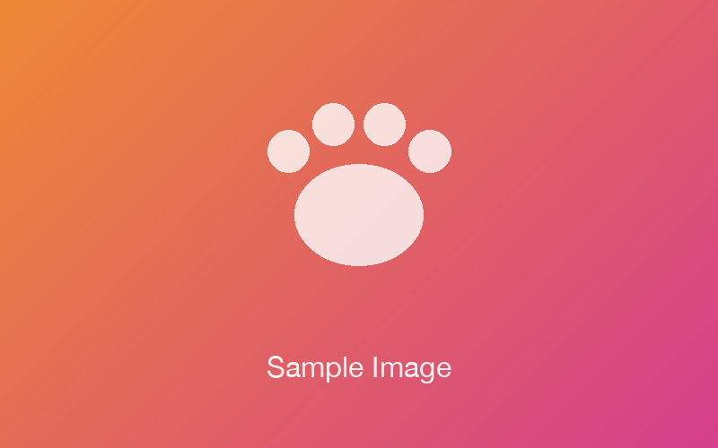

Nekote Blogで使えるマークダウン記法のサンプル集です。それぞれの記法について、コードブロックとそのすぐ下の表示を見比べられます。

記法ごとのルールや制限は[ドキュメント](https://nekote.blog/docs/others#markdown記法の詳細github連携)にまとまっています。

## frontmatter

ファイル先頭の`---`で囲まれた部分がfrontmatterです。記事のタイトルなどのメタ情報をYAML形式で書きます。

```md
---
title: 記事のタイトル
tags: [日記, お知らせ]
---

本文
```

必須なのは`title`だけです。使えるキーの一覧は[ようこそ記事](./welcome.md)にまとまっています。

## テキスト

### 見出し

```md
## 見出し

### 小見出し
```

この記事の各見出しが、そのまま表示例です。見出しのレベルは自動で整えられます。記事タイトルが`h1`、本文でいちばん上の見出しが`h2`になるようにずれるため、`# `始まりで書いても`## `始まりで書いても同じ表示になります。

### 段落と改行

```md
空行を挟むと、別の段落になります。

改行を1つ入れただけの行は、
同じ段落の中でつながります。

行末に半角スペースを2つ置くと、  
同じ段落のまま改行されます。
```

空行を挟むと、別の段落になります。

改行を1つ入れただけの行は、
同じ段落の中でつながります。

行末に半角スペースを2つ置くと、  
同じ段落のまま改行されます。

### テキストの装飾

```md
**太字**、*斜体*、~~打ち消し線~~、`インラインコード`が使えます。

記号の前に`\`を置くと、\*装飾にならずそのまま\*表示されます。
```

**太字**、*斜体*、~~打ち消し線~~、`インラインコード`が使えます。

記号の前に`\`を置くと、\*装飾にならずそのまま\*表示されます。

### HTMLタグ

一部のHTMLタグも書けます。使えるタグは安全な範囲に限られています（[使えるタグの一覧](https://nekote.blog/docs/others#htmlで書く)）。

```md
<kbd>Ctrl</kbd>+<kbd>K</kbd>のキー表記や、H<sub>2</sub>O、x<sup>2</sup>、<small>小さい文字</small>、<u>下線</u>が書けます。
```

<kbd>Ctrl</kbd>+<kbd>K</kbd>のキー表記や、H<sub>2</sub>O、x<sup>2</sup>、<small>小さい文字</small>、<u>下線</u>が書けます。

### 脚注

```md
本文に脚注を付けられます[^1]。

[^1]: 脚注の本文です。記事の末尾にまとめて表示されます。
```

本文に脚注を付けられます[^1]。

[^1]: 脚注の本文です。記事の末尾にまとめて表示されます。

## ブロック

### リスト

```md
- 箇条書き
- 箇条書き
  - 入れ子にできます

1. 番号付きリスト
2. 番号付きリスト

- [ ] タスクリスト（未完了）
- [x] タスクリスト（完了）
```

- 箇条書き
- 箇条書き
  - 入れ子にできます

1. 番号付きリスト
2. 番号付きリスト

- [ ] タスクリスト（未完了）
- [x] タスクリスト（完了）

### 引用

```md
> 引用文です。
> 行を続けて書くと、ひとつの段落にまとまります。
>
> `>`だけの行を挟むと、段落を分けられます。
```

> 引用文です。
> 行を続けて書くと、ひとつの段落にまとまります。
>
> `>`だけの行を挟むと、段落を分けられます。

### 区切り線

```md
---
```

---

### テーブル

区切りの行に`:`を付けると、列の文字の揃え方を指定できます（`:---`で左、`:---:`で中央、`---:`で右）。

```md
| メニュー | 種類 | 価格 | おすすめ度 |
| --- | --- | ---: | :---: |
| ブレンドコーヒー | 飲み物 | 450円 | ★★★ |
| チーズケーキ | デザート | 600円 | ★★★ |
| サンドイッチ | 軽食 | 750円 | ★★☆ |
```

| メニュー | 種類 | 価格 | おすすめ度 |
| --- | --- | ---: | :---: |
| ブレンドコーヒー | 飲み物 | 450円 | ★★★ |
| チーズケーキ | デザート | 600円 | ★★★ |
| サンドイッチ | 軽食 | 750円 | ★★☆ |

### コードブロック

言語名を付けると、シンタックスハイライトが効きます。さらにフェンスへ`title="…"`を足すと、ファイル名などのキャプションが付きます。

````md
```js title="app.js"
export function greet(name) {
  return `Hello, ${name}!`;
}
```
````

```js title="app.js"
export function greet(name) {
  return `Hello, ${name}!`;
}
```

### 数式

`$`で囲むと文中の数式、`$$`で囲むとブロックの数式になります。

```md
文中の数式: $a^2 + b^2 = c^2$

$$
x = \frac{-b \pm \sqrt{b^2 - 4ac}}{2a}
$$
```

文中の数式: $a^2 + b^2 = c^2$

$$
x = \frac{-b \pm \sqrt{b^2 - 4ac}}{2a}
$$

### コールアウト

`:::`で囲むと、補足や注意書きを枠付きで目立たせられます。種類は`tip`・`info`・`note`・`warning`・`alert`・`check`・`help`の7つです。

```md
:::tip[ここがポイント]
`[...]`でタイトルを付けられます。**強調**や`コード`もそのまま使えます。
:::
```

:::tip[ここがポイント]
`[...]`でタイトルを付けられます。**強調**や`コード`もそのまま使えます。
:::

タイトルの省略・色の変更・入れ子などの例は、[コールアウトの書き方サンプル](https://demo.nekote.blog/callout-guide)にあります。

### 折りたたみ

```md
:::details[クリックで開く]
折りたたまれていた中身です。中身も**マークダウンとして**解釈されます。
:::
```

:::details[クリックで開く]
折りたたまれていた中身です。中身も**マークダウンとして**解釈されます。
:::

### カラム

カラムはHTMLで書きます。外側の`div`に`b--columns l--switchColumns`、各カラムの`div`に`l--flow`を付けます。タグの前後に空行を入れると、カラムの中身をマークダウンで書けます。

```md
<div class="b--columns l--switchColumns">

<div class="l--flow">

左のカラムです。リストや画像も入ります。

</div>

<div class="l--flow">

右のカラムです。

</div>

</div>
```

<div class="b--columns l--switchColumns">

<div class="l--flow">

左のカラムです。リストや画像も入ります。

</div>

<div class="l--flow">

右のカラムです。

</div>

</div>

見出しにした折りたたみ・入れ子・3列のカラムなどの例は、[折りたたみとカラムの書き方サンプル](https://demo.nekote.blog/toggle-column-guide)にあります。

## メディア

### 画像

リポジトリ内の画像を相対パスで参照すると、同期時にNekote側へコピーされて配信されます。

```md

```


### リンク付きの画像

画像を`[...](リンク先のURL)`で囲むと、リンク付きの画像になります。

```md
[](https://nekote.blog)
```

[](https://nekote.blog)

### 画像の幅を指定する

HTMLの``を使うと、幅を指定できます。

```md

```


### 文中に小さい画像を入れる

テキストに続けて``を書くと、文中に小さい画像を入れられます。

```md
テキストに続けてのように入れられます。
```

テキストに続けてのように入れられます。

### 図とキャプション

```md
:::figure[画像のキャプション]

:::
```

:::figure[画像のキャプション]

:::

### 動画

リポジトリ内のmp4・webm・movへの相対リンクは、動画プレイヤーになります。

```md
[サンプル動画](../media/sample-video.mp4)
```

[サンプル動画](../media/sample-video.mp4)

### 音声

```md
::audio{url="../media/sample-audio.mp3"}
```

::audio{url="../media/sample-audio.mp3"}

### ファイル

```md
::file[サンプルPDF]{url="../media/sample-document.pdf"}
```

::file[サンプルPDF]{url="../media/sample-document.pdf"}

外部の画像・動画へのキャプション・PDFへのリンクなどの例は、[画像・動画・音声・ファイルの書き方サンプル](https://demo.nekote.blog/media-guide)にあります。

## リンク・埋め込み

### リンク

```md
[Nekote Blog](https://nekote.blog)への外部リンク。

同じリポジトリ内の記事への相対リンク: [ようこそ記事](./welcome.md)
```

[Nekote Blog](https://nekote.blog)への外部リンク。

同じリポジトリ内の記事への相対リンク: [ようこそ記事](./welcome.md)

記事ファイルへの相対パスで書いたリンクは、その記事の公開URLへ自動で書き換えられます。

### URLだけの段落

URLだけを1行で書くと、リンクカードになります。

```md
https://lism-css.com
```

https://lism-css.com

YouTubeやXなどの対応サービスのURLは、リンクカードではなく埋め込みコンテンツになります（下の「埋め込み」）。

### リンクカード

`::linkCard`と書くと、対応サービスのURLでも埋め込みではなくカードになります。

```md
::linkCard{url="https://www.youtube.com/watch?v=4I8f8y2IGBs"}
```

::linkCard{url="https://www.youtube.com/watch?v=4I8f8y2IGBs"}

キャプションの付け方や、同じブログの記事をカードにする例は、[リンクとリンクカードの書き方サンプル](https://demo.nekote.blog/link-guide)にあります。

### 埋め込み

`::embed`と書くと、埋め込みの意図をはっきり示せます。表示はURLだけの段落と同じです。

```md
::embed{url="https://vimeo.com/347119375"}
```

::embed{url="https://vimeo.com/347119375"}

対応サービスの一覧とサンプルは、[埋め込みコンテンツの書き方サンプル](https://demo.nekote.blog/embed-guide)にあります。

## 色

### 文字の色

```md
<span class="-c:keycolor -keycolor:red">赤い文字</span>と<span class="-c:keycolor -keycolor:blue">青い文字</span>
```

<span class="-c:keycolor -keycolor:red">赤い文字</span>と<span class="-c:keycolor -keycolor:blue">青い文字</span>

### マーカー

`==`で囲むとマーカーになります。色を選ぶときは`:marker[テキスト]{色名}`と書きます。

```md
==マーカーを付けた文字==と:marker[黄色のマーカー]{yellow}
```

==マーカーを付けた文字==と:marker[黄色のマーカー]{yellow}

色名は`gray`・`brown`・`orange`・`yellow`・`green`・`blue`・`purple`・`pink`・`red`の9つです。9色の見本は、[文字の色とマーカーの書き方サンプル](https://demo.nekote.blog/color-guide)で見比べられます。
